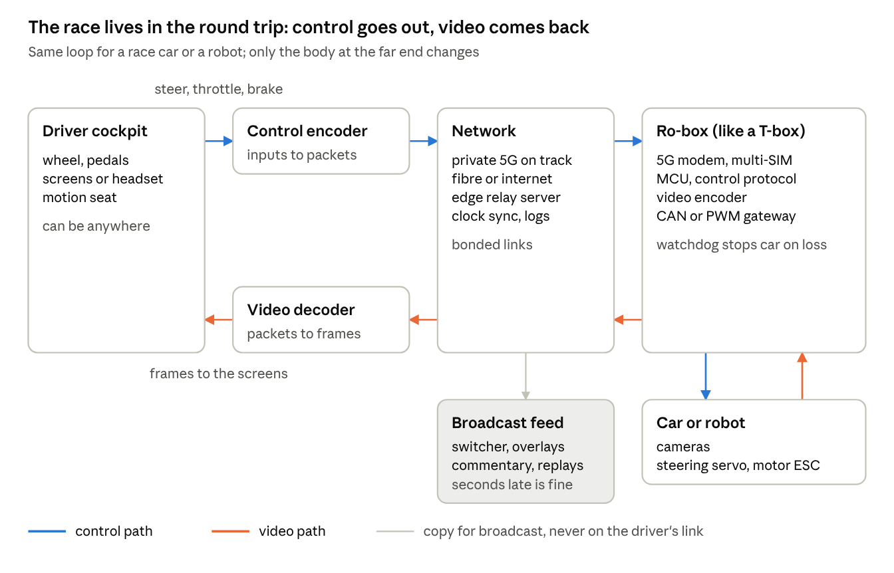

# HURA GP × Phygital AI — Story, Tech & Shooting Plan

Oct 30, 2026 · @Lan Wu

## Executive read

The story is not "a racing game with real cars". The story is that a Chinese company is using a sports event to prove, in public and under pressure, the one technology every robot company in the world still needs: a human controlling a physical machine from thousands of kilometres away, fast enough that the machine does not crash. Racing is the test. Robots are the business. If the film makes that connection in the first minute, a Western audience that does not care about model cars will watch to the end.

**What the two companies are, in one breath each.** Online, the name "Phygital AI" does not appear; the public cluster is the HURA brand (operator 互然焕速（上海）科技有限公司, chairman and brand founder 刘云鹤, CEO 谢天), the technology company Intedigo (中智蓝途, teleoperation cloud, TeleDrive, RoBOX), and a Swedish arm, HURA Europe AB, whose founder appears in English as Daniel Liu. Confirm with them which name goes on screen. Intedigo is the teleoperation platform: telecom link, low-latency video, control encoding and the vehicle-side RoBOX, which plays the role the T-box plays in a car. HURA GP is the sports brand on top of it: 1:8-scale electric race cars on a physical track at HURA PARK in Anting, Shanghai, drivers in full-motion simulator cockpits who can be anywhere, and a broadcast product that makes it watchable. The robot competitions are announced intent so far, using the same stack with a different body on the far end.

**Why the West should care (the three hooks, ranked).**

1. Stakes. Sim racing's permanent weakness is that nothing is real. Here the crash is real, the tyre wear is real, and the driver still only sees a screen. That tension is the sport.
2. The bridge technology. Full autonomy is late everywhere. The interim answer, from Las Vegas to Shenzhen, is a human in the loop at a distance. Vay drives real cars this way in Las Vegas; humanoid companies collect training data this way; HURA GP turns it into a spectator event. Racing is the most demanding public benchmark for teleoperation latency you could design.
3. A sport format that could travel. If the latency physics works across borders, a driver in Stockholm can race a car in Shanghai on a Saturday night. That is a new kind of international competition, and China is the one trying it first.

**My honest take on the brief you were given.** The attached list is a product-strategy consultation, not an interview. It has 19 sections and about 85 questions, most beginning with "could you" (能否), which invites the company to speculate about features it has not built. A film needs the opposite: stories, numbers, demonstrations and admissions. Roughly 15 of those questions survive as interview material, mostly from the latency, fairness, data and unit-economics sections; the rest are good input for a strategy workshop with the founders, not for camera. Section 7 of this doc sorts them.

**Two claims to verify before you repeat them on camera.** "First in the world" is wrong: Surrogate.tv in Finland let anyone race real 1:43 cars over the internet from 2019 until it went bankrupt in October 2022, and Einride drove a truck on a Swedish test track from Barcelona in 2019. "The only active example anywhere of remote physical racing run as a broadcast sport, and the first in China" is what the research supports, and it is a better claim because it is specific and survives a fact-check. Section 3 gives the comparables.

**The spine I would shoot.** One race, one driver, one robot operator, one number. The number is the end-to-end latency in milliseconds, said out loud by the CTO, then felt by a driver, then explained to the audience with a single diagram. Everything else in the episode hangs on that number.

**What would change my mind.** If the company's real differentiator turns out to be the event IP and community rather than the stack (for example, if they run on an off-the-shelf teleoperation vendor), the film shifts from "technology company that found a sport" to "sports company that found a technology". Ask the CTO the stack-ownership question (section 6) early, before you lock the narrative.

## The technology, explained for the camera

Everything the company does is one closed loop with two legs. Control goes out: the driver turns a wheel, the input becomes packets, the packets cross a network and a box on the car turns them into steering and throttle. Video comes back: a camera on the car captures a frame, a chip compresses it, it crosses the same network and appears on the driver's screen. The race is decided by how fast that loop closes, measured in milliseconds, and by how the system behaves when the network misbehaves.

Read it left to right for control and right to left for video. The driver only ever sees the video leg, so every millisecond on the right-to-left path is a millisecond the car has already moved.

**The T-box analogy you can use on camera.** In a modern car the T-box (telematics control unit) is the module with the 4G or 5G modem, a small processor, a GNSS receiver and a gateway onto the CAN bus. It phones home, takes over-the-air updates and lets an app unlock the doors. The Ro-box is a T-box built for the opposite direction of trust: instead of the car reporting to the cloud, a human on the other side of the network drives the car in real time. That adds four things a T-box does not need: a hardware video encoder, a control protocol tuned for tiny, frequent packets, tight clock synchronisation between both ends, and a watchdog that stops the car the moment the link drops. Ask the CTO which of those four they built themselves and which they bought.

**The latency budget.** The figures below are approximate, drawn from public teleoperation practice (Vay, Ericsson, the 5G remote-driving demos), and are what a serious team would recognise. Use them to calibrate the CTO's answer, not to quote as fact.

| Stage | Typical, approx. | What drives it |
| --- | --- | --- |
| Camera capture and encode on the car | 10 to 30 ms | exposure time, encoder settings (no B-frames, short GOP), hardware encoder |
| Uplink from car over private 5G on the track | 10 to 30 ms | 5G air interface and scheduling |
| Transit, same city or country | 5 to 40 ms | fibre route and number of hops |
| Transit, Shanghai to Stockholm, one way | 75 to 90 ms | 7,800 km great circle; fibre physics alone is about 40 ms; measured China to Europe round trips run 150 to 170 ms |
| Decode and display in the cockpit | 10 to 30 ms | decoder, screen refresh (a 60 Hz panel alone adds up to 16 ms) |
| Driver reaction | 150 to 250 ms | human, the same for everyone, not the system |
| Control packet back to the car | 10 to 40 ms domestic | small packets, far less sensitive than video |
| Actuator response | 10 to 30 ms | steering servo and motor controller |

Added up, a well-built domestic system shows the driver a frame roughly 80 to 150 ms after it happened, and a cross-border one roughly 200 to 300 ms. Sim racers complain about 50 ms of input lag. That gap is the whole engineering story, and it is why a cross-border final is a genuine stunt rather than a marketing line.

**What the company itself claims** (from the July 2026 Fibocom and Intedigo [press release](https://www.prnewswire.com/news-releases/from-remote-racing-to-embodied-ai-fibocom-and-intedigo-bring-5g-bidirectional-data-transmission-into-real-world-applications-302828996.html) and Jiading government [coverage](https://news.qq.com/rain/a/20250506A02M7N00)): 1080p at 60 Hz, glass-to-glass video under 80 ms, control latency under 10 ms, cars at 1:8 scale with a claimed top speed of 100 km/h, and private 5G on a Fibocom FM160 module. At the March 2026 season final the cockpits were about 10 km from the cars; at WAIC in July 2026 visitors drove a car about 30 km away. Those are the numbers to put to the CTO: ask how they measure 80 ms, and what the number was at 30 km.

**The five techniques to ask about, in plain words.**

1. Multi-link bonding: two or three SIM cards or links at once, so one bad cell does not end the race.
2. Forward error correction instead of retransmission: send a little extra data so a lost packet never has to be asked for again, because asking costs a full round trip.
3. Edge relay: a server close to the track that stitches, records and forwards, so the cockpit can be anywhere without the car caring.
4. Predictive display: the cockpit draws where the car probably is now, not where it was 150 ms ago, using the car's own motion model. This is also the fairness question, because prediction is an assist.
5. Equal-latency rule: deliberately delaying the faster driver's link so both drivers race on the same delay. If they do this, it is a great on-camera moment; if they do not, ask how they justify a cross-border grid.

**Broadcast is a different problem from control.** The control loop must stay under a few hundred milliseconds or the car crashes. The broadcast feed can run seconds behind and nobody minds, which is why the production team can add overlays, replays and commentary without touching the driver's link. The broadcast lead and the CTO will describe the same race with different numbers; the film should show both, side by side, because the contrast is the explanation.

**Why a race car is the right test for a robot.** A humanoid walking across a room tolerates half a second of delay. A scale car at speed does not. If the stack survives racing in public, the robot case is easy by comparison, and the company gets its most demanding benchmark for free, with a crowd watching. That sentence, said by the CTO on camera, is the bridge between the two halves of the episode.

## World landscape: who else does this

Nobody runs remote physical racing as a broadcast sport today, anywhere. The one serious attempt, Surrogate.tv in Finland, went bankrupt in October 2022. Every major robot competition, including the Chinese ones, keeps the operator in the venue. So the defensible line is: HURA GP is the only active example we could find of drivers racing real cars from kilometres away in front of an audience, and nobody outside academic contests has run a cross-border remote robot competition.

| Who | What it is | Status | Where the human sits | What it gives the film |
| --- | --- | --- | --- | --- |
| [Surrogate.tv](https://techcrunch.com/2020/12/18/remote-physical-gaming-site-surrogate-tv-raises-a-2-5m-seed), Finland | browser racing of real 1:43 cars over the internet; ran a remote Mario Kart Live tournament in 2020 | bankrupt Oct 2022 | anywhere | proved the idea at hobby scale and died: lag, and no sport built around it |
| [Avicar Remote Reality](https://www.motor1.com/news/656304/avicar-remote-reality-drivers-race-remotely/), US | VR-driven full-size zero-seat electric race cars with a Siemens digital twin, announced Mar 2023 | no race found since | remote | the Western press loved the idea; nobody shipped it |
| [Vay](https://hoodline.com/2026/04/remote-drivers-invade-downtown-as-vay-supercharges-vegas-fleet/), Berlin and Las Vegas | commercial teledriven car-sharing, about 175 cars in Las Vegas by Apr 2026 | active | a local teledrive centre | the Western proof that teledriving is a business, at city speeds |
| [Ericsson, Deutsche Telekom and Vay](https://www.ericsson.com/en/news/2023/2/ericsson-dt-and-vay-demo-5g-teledriving), MWC 2023 | car in Berlin driven from Barcelona over a 5,000 km routed path with L4S | one-off demo | 1,500 km away | the cross-border reference: video frames never over 200 ms |
| [Einride](https://spectrum.ieee.org/mwc-barcelona-2019-on-the-road-to-selfdriving-cars-5g-will-make-us-better-drivers), MWC 2019 | truck on the AstaZero track in Sweden driven from Barcelona with a gaming wheel | one-off demo | about 2,500 km away | the Swedish precedent you can name on camera |
| [A2RL](https://www.pmw-magazine.com/news/race-series-news/worlds-largest-autonomous-racing-league-returns.html), Abu Dhabi | autonomous full-size race cars, USD 2.25M prize pool, on Motorsport TV and YouTube, human-versus-AI showcases | active, season 2 final Nov 2025 | no human; AI drives | the robot-racing broadcast format the West already watches |
| [Drone Racing League](https://en.wikipedia.org/wiki/Drone_Racing_League), US | FPV drone racing on ESPN and NBC | no 2025 or 2026 season found | in the venue, radio line of sight | the TV grammar: pilot cam, first-person feed, head to head |
| [RoboMaster](https://qz.com/1342950/dji-is-turning-robot-battles-into-the-next-college-sport-advantage-china), DJI, Shenzhen | 7v7 robot combat, pilots on PCs with a first-person feed, finals on Twitch | active | arena side | China's closest robot esport; operators on site |
| [World Humanoid Robot Games](https://english.beijing.gov.cn/beijinginfo/sci/latesttrends/202608/t20260825_4836357.html), Beijing | 666 teams and 51 disciplines in Aug 2026; remote control allowed with a scoring penalty | active, annual | in the venue with handheld controllers | China's robot stage is enormous; nobody runs it from another country |
| [CMG Mecha Fighting](https://www.livescience.com/technology/robotics/china-pits-rival-humanoids-against-each-other-in-worlds-first-robot-boxing-tournament), Hangzhou May 2025 | four Unitree G1 humanoids boxing, on CCTV | one-off, more planned | ringside with handheld controllers | proof that Chinese TV will broadcast robot combat |
| [ANA Avatar XPRIZE](https://cosmiclog.com/2022/11/06/german-robotics-team-wins-avatar-xprize-showdown/), Nov 2022 | USD 10M telepresence-robot contest judged by remote operators | finished | a separate room in the same venue | the academic high-water mark; still not long distance |
| [Mercury Remote Robot Challenge](https://news.okstate.edu/articles/engineering-architecture-technology/2018/mercury-remote-robot-challenge-oklahoma-state-unviersity), Oklahoma State | student robots driven over the internet from at least 50 miles away | active since 2010, academic | across the US and Latin America | the only standing cross-site remote robot contest; no broadcast |

**Is it the first in China?** Small Chinese apps for driving scale cars over 4G or 5G exist (华制远控, 飞车乐园), but they are hobby products with no event and no broadcast, and RoboMaster keeps its pilots at the arena. We found no earlier Chinese event with the drivers kilometres from the cars, a ticketed audience and a live production. Say "we found no earlier example" rather than "first"; it is stronger because it is checkable.

**How to say it on camera, in one breath.** Finland tried this in 2019 and the company folded. Abu Dhabi races cars with no driver at all. Beijing races robots with the operator standing beside them. Shanghai is the one place where the driver is ten kilometres away and the crowd is watching.

**Who the Western audience will compare them to.** Drone Racing League for the look, BattleBots and RoboMaster for the robot angle, A2RL for the autonomous rival, Vay for the business. Use those names in the narration; they do the explaining for you.

## The story: audience, hooks and the spine

The episode proves one sentence: a human can drive a real car from far away, fast enough to race, and the same trick is how robots will be run before they can run themselves. Everything that does not serve that sentence is B-roll.

**Who it is for.** The Circuit's audience: tech-curious generalists who watch Bloomberg and YouTube, plus two groups you care about personally, engineers at Ericsson and ABB who will judge the latency claims, and investors who want to know whether physical AI in China is real. They want five answers, in this order: is it real, what does it feel like, what is the number, why China and why now, and what comes next.

**Working titles.** "The 80-Millisecond Race" (their own claim, which the film tests). "Driving Shanghai from Stockholm" (if the cross-border set-piece happens). "The Remote Grand Prix" (safe).

**Hooks for a Western viewer, ranked by how hard they land.**

1. The referee is physics. A sport where the fastest driver can lose to the speed of light. Nobody has heard that before.
2. A Shanghai company opened a Swedish entity. HURA Europe AB exists; the Stockholm driver is not a fantasy, and you are the natural bridge. This is also the reason a Swedish-based studio is the right teller.
3. Drone Racing League meets Vay. Two things the audience already knows, combined into one they do not.
4. 80 ms versus 200 ms. The company claims glass-to-glass under 80 ms; Vay's cross-border demo with Ericsson said frames never exceed 200 ms. The film puts a stopwatch on the claim.
5. Who said robots have to be autonomous? Beijing's robot games let operators remote-control with a scoring penalty. HURA's bet is that remote humans are the product, not the embarrassment.

**What The Circuit actually does, and what to borrow.** The 2023 episode with Satya Nadella and Sam Altman ("Dawn of the AI Wars", about 23 minutes) opens on an artefact, Bill Gates's 1995 "Internet Tidal Wave" memo, and asks one yardstick question: is AI as big? The 2025 Microsoft-at-50 episode (about 43 minutes) runs three separate sit-downs, Gates, Ballmer, Nadella, on the Redmond campus, cross-cut around one theme, then closes on a rapid-fire round. The 2025 Stargate episode with Altman, shot on the Abilene site, is the show's reported-documentary mode and the one that earned an Emmy nomination. Borrow three things: an artefact to open on, here the latency counter or a crashed car; separate sit-downs cross-cut on one theme, here "the number"; and the site visit as the spine, not the office. The timings in the shooting plan are reconstructed from listings and recaps, since the transcripts were not reachable; treat them as a template, not a transcript.

**What got clipped from her episodes, and the equivalent you need.** The 2023 clip that travelled was Nadella calling AI "a tidal wave as big as the internet"; the second was "how Sam Altman uses ChatGPT daily". Each episode needs one quotable claim from the founder and one personal-habit clip. Your candidates: the founder's one-line definition of the sport (event director, question 2), and a driver describing what 80 milliseconds feels like in the body (driver, question 1).

**The emotional arc, in four beats.** A driver loses a final by a margin smaller than the network delay. A car crashes and the driver, ten kilometres away, feels nothing and sees everything. You sit in the cockpit, drive a lap, and crash. The founder explains why, after all that, the real plan is robots. End on the robot run, with the operator somewhere far away, and the counter on screen.

**What you must not do.** Do not let it become a corporate video. The sceptic's question (event director, question 12) and the honest-limits question (CTO, question 13) stay in the cut, even if the company asks you to remove them. That is what makes the rest believable.

## Shooting plan

The shooting plan is in `hura-gp-shooting-plan.md`. It covers format, rundown, shoot days, shot list, crew and gear, graphics to request, and deliverables.

## Script and interview questions

The script and the question bank are separate, written for you to read and practise: `hura-gp-script-and-questions.md`. Nothing in it is production logistics.

## Assessment of the friend's question list

The list is a good strategy workshop and a poor interview. Of its 19 sections, six survive on camera as they are, seven survive after reframing into a story or a number, and six belong in a founders' workshop. The rule applied: a camera question must produce a story, a number, a demonstration or an admission. "Could you add drifting" produces none of those.

| Section | Verdict | Why, and where it went |
| --- | --- | --- |
| 1 出海, international league | reframe | became the Stockholm driver question (event director 9); the Swedish entity makes it concrete |
| 2 赛事玩法, drift, rally, voting | workshop | feature wish list; nothing to film |
| 3 联动, real circuits, GT games | reframe | became "who wins: sim racers or track drivers" (event director 7); partnerships off camera |
| 4 公平性, fairness | keep | the best section; event director 5, CTO 6 |
| 5 转播, broadcast | keep | became broadcast 2 to 5 |
| 6 社区, community | reframe | became audience numbers (event director 8) and "what changed quietly" (13) |
| 7 IP 联动, 四驱兄弟, 头文字 D | reframe | one rapid-fire line: Initial D or Drive to Survive; Initial D is known in the West |
| 8 自有 IP | workshop | speculative; no story yet |
| 9 用户参与, liveries, AR | workshop | nothing to show |
| 10 低延迟, latency | keep | the spine; CTO 2 to 5 and 8 |
| 11 AI 预测, prediction | keep | CTO 6, tied to fairness |
| 12 物理反馈, motion seat | reframe | became the driver's "describe it in your body" and a CTO rapid-fire |
| 13 VR, AR, digital twin | mostly cut | covered by "where the car is or where it will be" |
| 14 模块化赛道 | workshop | track logistics |
| 15 数据与具身智能, data | keep | CTO 11; the business the West is paying for |
| 16 AI 赛车, human versus AI | reframe | one rapid-fire: would you race your champion against an AI, as A2RL does |
| 17 Benchmark platform | reframe | a follow-up to CTO 11, otherwise workshop |
| 18 与游戏差异化 | keep | became the crash (event director 4), the sceptic (12) and the novelty closer |
| 19 商业模式, unit economics | reframe | one money question on camera (event director 11); cars per hour off camera |

**Three questions from the list that are better than anything I wrote, kept verbatim in spirit.** "If you take away the first-time novelty, why does anyone come back?" (section 18, now a closer). "Can the system run on an ordinary home connection?" (section 10, now CTO 8). "Does prediction affect fairness?" (section 11, now CTO 6).

**What to do with the rest.** Send the workshop sections back to the company as a written strategy memo after the shoot, under your name. It is a gift that costs you nothing and it positions the studio as a partner, not a crew.

## Pre-shoot checklist and next steps

The single decision that shapes the episode: whether a driver in Sweden races a car at HURA PARK during the shoot. HURA Europe AB exists, the company has driven a car from 30 km away in public, and the physics says a Shanghai to Stockholm round trip is about 160 ms. If they agree, it is the set-piece and the title. Ask in the first pre-interview call.

**Names and identity to confirm before anything goes on screen.**

- [ ] Which name goes on screen: Phygital AI, HURA, Intedigo (中智蓝途), or 互然焕速. The research found no public use of "Phygital AI".
- [ ] Whether Daniel Liu and 刘云鹤 are the same person, and his title on each entity.
- [ ] CEO 谢天's role versus the chairman's; who is "the founder" for the film.
- [ ] Date, venue and format of the final you will shoot; the 2026 calendar implied a November finale that was not announced when this was written.

**Materials to request from the company.**

- [ ] Their latency measurement method and one real log from a race (how the 80 ms and 10 ms were measured).
- [ ] Clean broadcast feed and programme feed from the March 2026 final, plus onboard camera recordings.
- [ ] WAIC July 2026 demo footage (the 30 km drive) and the Fibocom materials.
- [ ] HURA PARK floor plan and a list of cockpits, cars and track layout.
- [ ] Driver list for the final with each driver's location on race day.
- [ ] Permission for you to drive a lap on camera with the latency counter on screen.
- [ ] Any robot hardware they will show, and whether an operator can run it from outside Shanghai during the shoot.
- [ ] Logo use, release forms for drivers, and the contact at HURA Europe AB.

**Pre-interview calls, 30 minutes each, no camera.**

- [ ] CTO: walk the block diagram, agree the demonstration, ask build-versus-buy off the record first.
- [ ] Event director: the origin story, the crash story, the fairness rule; find out which stories they tell well.
- [ ] Broadcast lead: feed access, camera positions, what they will let you overlay.

**Next steps I suggest, in order.**

1. Send the company a two-paragraph note on what the film is and is not (the one-sentence thesis, the sceptic question stays in). Get a yes before investing crew days.
2. Decide the cross-border set-piece with them.
3. Lock the three sit-downs and one shoot day at the track with a live session.
4. Record the pre-interviews; the script tab gets revised from what they actually say.

**Sources read for this brief.** [Fibocom and Intedigo press release, July 2026](https://www.prnewswire.com/news-releases/from-remote-racing-to-embodied-ai-fibocom-and-intedigo-bring-5g-bidirectional-data-transmission-into-real-world-applications-302828996.html) · [HURA PARK trial opening, Jiading, May 2025](https://news.qq.com/rain/a/20250506A02M7N00) · [China Daily on Hura Park, May 2025](https://subsites.chinadaily.com.cn/jiading/2025-05/12/c_1091978.htm) · [2026 HURA GP S1 final, chinanews, Mar 2026](https://www.sh.chinanews.com.cn/tiyu/2026-03-16/145289.shtml) · [HURA and World Phygital Community MOU](https://worldphygital.org/news/hura-and-wpc-sign-mou-for-tech-sports-collaboration/) · [Phygital International on HURA](https://phygitalinternational.com/blog/post/phygital-racing-hura-delivers-a-grand-prix-experience-for-all/) · [HURA Europe](https://huraracing.se/) · [Intedigo](https://www.intedigo.com/) · [Vay and Ericsson L4S teledriving deep dive](https://vay.io/deep-dive-how-to-break-the-congestion-barrier-achieving-low-latency-with-high-throughput-for-safe-teledriving/) · [The Circuit, Dawn of the AI Wars, Aug 2023](https://www.bloomberg.com/news/articles/2023-08-17/microsoft-ceo-says-ai-is-a-tidal-wave-as-big-as-the-internet) · [The Circuit, Microsoft at 50, Jun 2025](https://www.bloomberg.com/news/videos/2025-06-05/microsoft-the-tech-giant-s-50-years-video). Chinese sites and Bloomberg pages were summarised from search results because direct fetches were blocked from this environment; figures marked approximate are from public teleoperation literature, not from the company.
